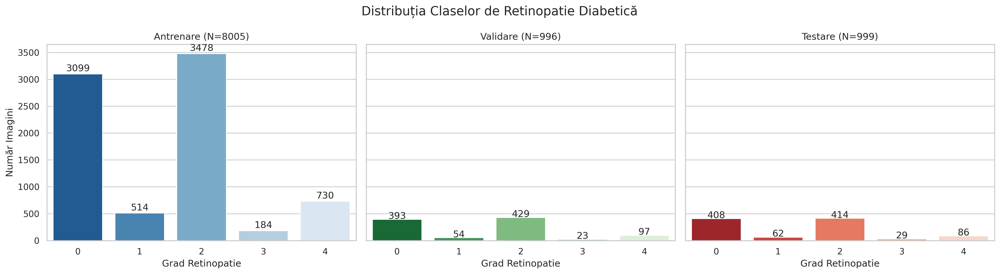
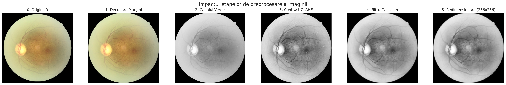
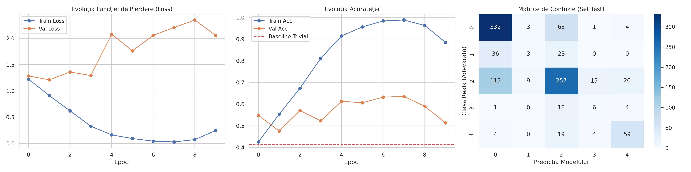

# Diabetic Retinopathy Severity Classification 👁️🩺

[](https://www.python.org/)
[](https://pytorch.org/)
[](https://opencv.org/)
[](https://colab.research.google.com/)

A deep learning pipeline built in **PyTorch** for classifying the severity of **Diabetic Retinopathy (DR)** from retinal fundus images into 5 clinical stages (0 to 4). Developed as Stage 1 of the *Supervised Learning* course project (Dataset B).

---

## 📌 Project Overview

Diabetic retinopathy is one of the leading causes of preventable blindness in adults. This project builds an end-to-end computer vision pipeline—from memory-efficient data loading and medical image preprocessing to transfer learning with **ResNet18**—achieving **65.77% test accuracy** and significantly outperforming the majority-class trivial baseline (**41.44%**).

### Clinical Severity Classes
| Label | Stage | Clinical Description |
| :---: | :--- | :--- |
| **0** | No DR | Healthy retina, no visible lesions |
| **1** | Mild NPDR | Microaneurysms only (very subtle red dots) |
| **2** | Moderate NPDR | Retinal hemorrhages, hard and soft exudates |
| **3** | Severe NPDR | Extensive intraretinal hemorrhages, venous beading |
| **4** | Proliferative DR | Neovascularization, preretinal/vitreous hemorrhages |

---

## 📂 Repository Structure

```text
diabetic-retinopathy/
├── README.md                   # Project documentation and results
├── tema1IS.ipynb              # Full Google Colab implementation (EDA, Preprocessing, Training)
├── RaportTema1IS.pdf          # Detailed technical report (Romanian)
├── Procente_Clase.csv          # Class distribution percentages across splits
├── Distributie_Clase.png       # Class distribution bar charts (Train / Val / Test)
├── Exemple_Clase.png           # Visual samples across all 5 severity classes
├── Preprocesare_Pasi.png       # Step-by-step preprocessing pipeline visualization
└── Evaluare_Model.png          # Loss/Accuracy curves and Test Confusion Matrix
```

> **Note on Large Files (Dataset & Model Weights):**
> Due to GitHub file size limits, the 10,000-image dataset (`tema_IS_setB.zip`, 402.5 MB) and trained model checkpoint (`best_baseline_model.pth`, 42.7 MB) are hosted externally on Google Drive:
> - 📥 **[Download Dataset (`tema_IS_setB.zip`)](https://drive.google.com/file/d/15Ts97cDMtSuyEa5i8Zv5PHL5LvFmdPdU/view?usp=drive_link)**
> - 📥 **[Download Best Model Weights (`best_baseline_model.pth`)](https://drive.google.com/file/d/1nwqUD3zx_JaaKZD_9WDFg_S9sgBy7Fl8/view?usp=drive_link)**

---

## ⚙️ Technical Pipeline

### 1. Memory-Efficient Data Loading (`Lazy Loading`)
A custom `RetinopathyDataset(torch.utils.data.Dataset)` class loads only `labels.csv` in `__init__`, reading and transforming images on-the-fly in `__getitem__`. This prevents RAM overflow when handling 10,000 high-resolution fundus images.

### 2. Leakage-Free Data Splitting
The dataset (10,000 RGB images across 25 different resolutions) was split into **80% Train (8,005) / 10% Validation (996) / 10% Test (999)** using `StratifiedGroupKFold(n_splits=10, random_state=42)`:
- **Group constraint (`group`):** Keeps all images belonging to the same patient strictly within the same subset, preventing **Data Leakage**.
- **Stratification (`label`):** Preserves the highly imbalanced clinical class distribution across all three subsets.



### 3. Medical Image Preprocessing
To address illumination variations (*covariate shift*), black borders, and varying image dimensions, a 5-step OpenCV + Torchvision pipeline is applied to every image:
1. **Black Border Cropping:** Contour detection (`cv2.findContours`) isolates the circular retina and removes uninformative black margins.
2. **Green Channel Extraction:** Hemoglobin absorbs green light most strongly, maximizing contrast for blood vessels, microaneurysms, and hemorrhages.
3. **CLAHE (`clipLimit=2.0`, `tileGridSize=(8,8)`):** Enhances local contrast to highlight fine vascular structures and exudates.
4. **Gaussian Blur (`5×5` kernel):** Suppresses high-frequency sensor noise amplified by CLAHE.
5. **Resize (`256×256`) & ImageNet Normalization:** Uniform tensor shape for batch processing, scaled to $[0, 1]$ and standardized with ImageNet mean/std.



### 4. Model Architecture & Training Setup
- **Backbone:** Pre-trained `ResNet18` (`ResNet18_Weights.DEFAULT`), fine-tuned end-to-end.
- **Classifier Head:** Replaced `model.fc` with `nn.Linear(512, 5)` to output logits for the 5 DR stages.
- **Loss Function:** Weighted `nn.CrossEntropyLoss` with inverse class-frequency weights to penalize errors on minority classes (1, 3, and 4).
- **Optimizer & Hyperparameters:** `Adam` (`lr = 1e-4`), `batch_size = 32`, `epochs = 10` on Google Colab T4 GPU.
- **Model Checkpointing:** Automatically saved the weights achieving the highest validation accuracy (**63.55%** at Epoch 8) to prevent evaluating an overfitted final epoch.

---

## 📊 Evaluation & Results (Test Set, $N = 999$)

| Metric | Score |
| :--- | :---: |
| **Trivial Baseline Accuracy** (always predicting Class 2) | `41.44%` |
| **ResNet18 Test Accuracy** | **`65.77%`** |
| **Macro Avg F1-Score** | `0.4728` |
| **Weighted Avg F1-Score** | `0.6398` |

### Per-Class Classification Report

| Class | Precision | Recall | F1-Score | Support |
| :---: | :---: | :---: | :---: | :---: |
| **0 (No DR)** | 0.6831 | 0.8137 | **0.7427** | 408 |
| **1 (Mild)** | 0.2000 | 0.0484 | **0.0779** | 62 |
| **2 (Moderate)** | 0.6675 | 0.6208 | **0.6433** | 414 |
| **3 (Severe)** | 0.2308 | 0.2069 | **0.2182** | 29 |
| **4 (Proliferative)** | 0.6782 | 0.6860 | **0.6821** | 86 |



### Key Takeaways
- **Strong performance on majority & severe classes:** The model reliably identifies healthy retinas (**Class 0**, F1 = 74.27%), moderate cases (**Class 2**, F1 = 64.33%), and proliferative cases (**Class 4**, F1 = 68.21%) thanks to CLAHE highlighting large hemorrhages.
- **Overfitting:** Training accuracy approaches ~99% while validation loss rises after Epoch 2–3, confirming the need for stronger regularization in the next stage.
- **Fine-grained transitions (Classes 1 & 3):** Microaneurysms in Class 1 are extremely subtle at $256 \times 256$ resolution, causing most Class 1 samples (36/62) to be misclassified as Class 0. Similarly, Class 3 (29 samples) is frequently confused with adjacent Class 2 (18/29).

---

## 🚀 Future Work (Stage 2)

To mitigate overfitting and improve recall on minority classes (1 and 3), the next iteration will focus on:
- **Aggressive Data Augmentation:** Random horizontal/vertical flips, rotations, and `ColorJitter` to handle orientation variability and covariate shift.
- **Regularization & Scheduling:** Adding `weight_decay` (L2), Dropout layers, and a Learning Rate Scheduler (`ReduceLROnPlateau` / `CosineAnnealingLR`).
- **Higher Input Resolution:** Scaling from $256 \times 256$ to $384 \times 384$ or $512 \times 512$ to preserve tiny microaneurysms.
- **Evaluation & Loss Tuning:** Selecting checkpoints based on **Macro F1-Score** or **Quadratic Weighted Kappa (QWK)**, and experimenting with Focal Loss or oversampling.

---

## 👤 Author

**Tudor-Mihai Ostin**  
GitHub: [@tudorostin](https://github.com/tudorostin)
